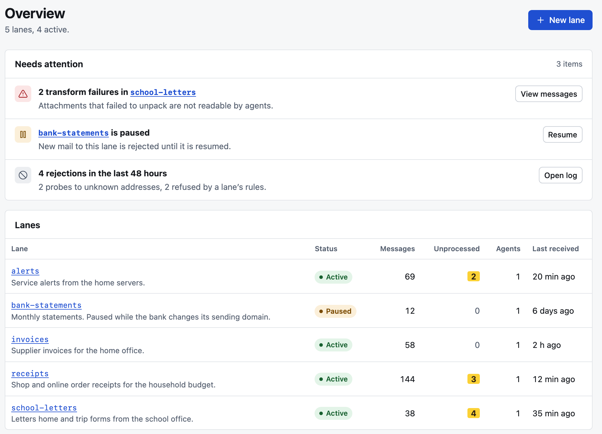

# cloudflare-agent-inbox

> [!WARNING]
> **Experimental software.** This project is early, was built for its author's own
> use, and has had little real-world use. Hand-forwarded mail has been checked end to
> end with one provider (iCloud Mail). The path for server-side forwarding rules has
> been tested with synthetic messages, and a real provider's ARC headers have been
> inspected, but no message has yet been accepted through it. Expect rough edges and
> breaking changes, and no stability or support guarantees. It handles **untrusted
> email on behalf of AI agents**: before pointing an agent at real mail, read
> [docs/security.md](docs/security.md), and give the agent only capabilities you
> would be comfortable with an attacker steering. Use it at your own risk.

A Cloudflare Worker that files forwarded emails into **lanes**, which AI agents
read through a narrow, mostly read-only MCP server. An admin CLI manages lanes,
agent tokens and secrets, and an optional web interface behind Cloudflare Access
covers the day-to-day tasks.

> **Unofficial.** This project is not affiliated with, endorsed by, or
> sponsored by Cloudflare. It runs on Cloudflare's developer platform and uses
> the name descriptively.

You forward chosen emails (receipts, invoices, notifications) from your own
mailbox to a lane's unguessable address. The Worker checks that the mail really
came from you, turns it into clean plain text, stores the original, and makes it
available to the agents you granted that lane, and nobody else.

## How it works

```
forwarded mail ─► Email Routing ─► email() handler
   1. address token → lane          unknown → drop silently
   2. sender + DKIM checks          fail    → drop silently
   3. lane paused                   verified sender → bounce (so you notice)
   4. size and attachment policy    fail    → drop silently
      (every rejection is logged headers-only, capped per day)
   5. clean text → D1; raw message and attachments → R2
   6. the lane's attachment transforms (e.g. unzip)

fetch() handler
   MCP host    /mcp/agent    bearer tokens, scoped to granted lanes
   share host  /s/<token>    short-lived download links
   admin host  (optional)    the admin interface, behind Cloudflare Access

scheduled() ─► retention purge, expired links, old rejections

agent-inbox CLI (your machine) ─► Cloudflare API: D1 and Workers secrets
```

- **Lanes are the unit of policy.** Each has its own address, allowed senders,
  attachment rules, transforms, size and retention limits.
- **Sender checks** accept mail you compose or forward by hand (DKIM for your
  domain) and, per lane, mail your provider forwards by a server-side rule
  (the provider's ARC record of the original sender). See
  [docs/security.md](docs/security.md).
- **Addresses** look like `inbox+<token>@<mail hostname>`. The token is 160
  random bits. Email Routing needs a single literal rule for
  `inbox@<mail hostname>`, with subaddressing enabled.
- **No AI in the pipeline.** Conversion to text is deterministic: HTML is
  converted to text (removal of hidden text is best effort: it catches common
  tricks, not every one), zero-width and bidi characters are
  removed, text is NFKC-normalised, links become `text (domain)`.
- **Agents** get a bearer token and four tools: `list_messages`, `get_message`,
  `create_share_link` and `mark_processed`. `list_messages` takes the lane name, which the agent has to be told. Body text and
  other third-party fields come back under names starting `untrusted`.

**New here?** Follow [docs/getting-started.md](docs/getting-started.md), or
paste the [agent-guided setup prompt](docs/agent-setup.md) into an agent.

See [docs/security.md](docs/security.md) for the threat model,
[docs/operations.md](docs/operations.md) for logs and diagnosing problems,
[docs/lanes.md](docs/lanes.md) for lane recipes,
[docs/ingest.md](docs/ingest.md) for the optional signed HTTP ingest endpoint and
[docs/deploy.md](docs/deploy.md) for deployment.

## Quick start

```sh
npx npm@11 install
export AGENT_INBOX_CLI_API_TOKEN=...      # narrow: Workers Editor and D1 Edit only
export CLOUDFLARE_ACCOUNT_ID=...
export AGENT_INBOX_WORKER_NAME=...        # also the D1 database name
export AGENT_INBOX_MAIL_HOSTNAME=mail.example.com

npm run cli -- lanes create receipts --description "Shop receipts"
npm run cli -- agents create my-agent       # interactive terminals only; prints the token once
npm run cli -- agents grant my-agent receipts
npm run cli -- messages inject-test receipts --text "Total 3.50 GBP"
```

`lanes create` prints the lane's address; point your mail rule at it.

## CLI

`npm run cli -- <command>`. Output is human-readable, or JSON with `--json`.
It prints metadata only; message bodies need `messages get <id> --show-body`.

| Command | Does |
| --- | --- |
| `lanes create\|list\|get\|update\|pause\|resume\|delete\|rotate` | manage lanes and their addresses |
| `agents create\|list\|grant\|ungrant\|revoke` | manage agent tokens and what they can read |
| `ingest-keys init\|create\|list\|revoke` | manage per-lane signing keys for [HTTP ingest](docs/ingest.md) |
| `secrets set LANE_SECRET_NAME` | set a Worker secret; the value is read from the terminal or stdin |
| `messages list\|get\|mark-unprocessed\|keep\|delete\|inject-test` | inspect and fix messages |
| `rejections list` | see what was rejected, and why |

Destructive commands (`lanes delete`, `lanes rotate`, `agents revoke`,
`messages delete`) ask for confirmation, or refuse in a non-interactive
session unless `--yes` is passed. Automation should not pass `--yes`.
`agents create` and `ingest-keys create` refuse to run unless they have a terminal, so a
token or secret is never captured by a tool or transcript.

## Admin interface

An optional web interface for the same tasks as the CLI (lanes, messages, agents and the
rejection log), served by the Worker on its own hostname behind Cloudflare Access. Email
content is only ever shown as text, and message bodies appear only when asked for. It is off
unless configured; see [docs/admin.md](docs/admin.md). To try it without deploying anything,
see [Running the admin interface locally](#running-the-admin-interface-locally).

<picture>
  <source media="(prefers-color-scheme: dark)" srcset="site/screenshots/overview-dark.webp">
  
</picture>

## HTTP ingest

An optional endpoint, `POST /ingest/lanes/<slug>` on its own hostname, lets a trusted program
file a raw message into one lane without forwarding it by email. Requests need a Cloudflare
Access service token and an HMAC signature from a key that belongs to that lane; repeats are
recognised and not stored twice. It is off unless configured; see [docs/ingest.md](docs/ingest.md).

## Configuration

Deployment values (hostnames, allowed senders, DKIM domains) are never
committed. `wrangler.example.jsonc` is a template; the real config is rendered at
deploy time from environment variables (see `.env.example`). You deploy with
`npm run deploy` from a clone, with no fork needed; Workers Builds is an optional
alternative. See [docs/deploy.md](docs/deploy.md).

Examples in this repository use `example.com` and made-up senders only.

## Threat model (summary)

Email bodies are untrusted data written by third parties. This project keeps
risk down with tight ingress control, per-lane scoping and a minimal agent
surface, not by filtering content. **Safety therefore also depends on what the
consuming agent is allowed to do**: give an agent that reads email only the
capabilities you would be comfortable with an attacker steering.

## Development

```sh
npx npm@11 install      # npm 10 can hit a peer-dependency bug with Vitest
npm test                # Vitest inside the Workers runtime
npm run typecheck
npm run build:admin     # build the admin app into dist/admin
npm run dev             # the admin interface locally, with synthetic data
npm run screenshots     # regenerate the pictures on the website (see docs/admin.md)
git config core.hooksPath .githooks   # enable the pre-commit scans
```

### Running the admin interface locally

```sh
npm run dev              # starts everything; seeds an empty local database
npm run dev -- --reseed  # throws the local data away and seeds it again
```

- <http://localhost:5173> is the app with hot reload.
- <http://localhost:8799> is the same Worker serving the built app, with the production
  content security policy. Set `DEV_WORKER_PORT` if that port is taken.

It runs the real Worker, including the real Access check, against a local D1 and R2
holding synthetic data (`dev/seed.sql`). A dev-only entry (`src/dev/worker.ts`) stands in for
Cloudflare Access and is never part of a deployment. Seeded attachments have no stored
files, so downloading them does not work. Details are in [docs/admin.md](docs/admin.md#local-development).

The pre-commit hook scans for personal values using a denylist you keep
outside the repository (`.pii-denylist`, which is git-ignored, or
`~/.config/agent-inbox/denylist.txt`; one term per line). `npm run pii-scan --
--history` scans every commit. CI runs
[gitleaks](https://github.com/gitleaks/gitleaks) on every push.

## Licence

MIT. See [LICENSE](LICENSE).
